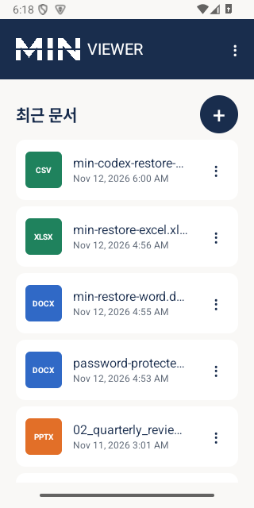
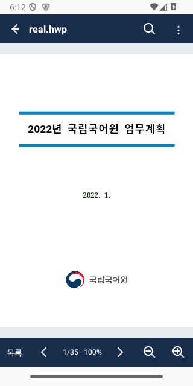
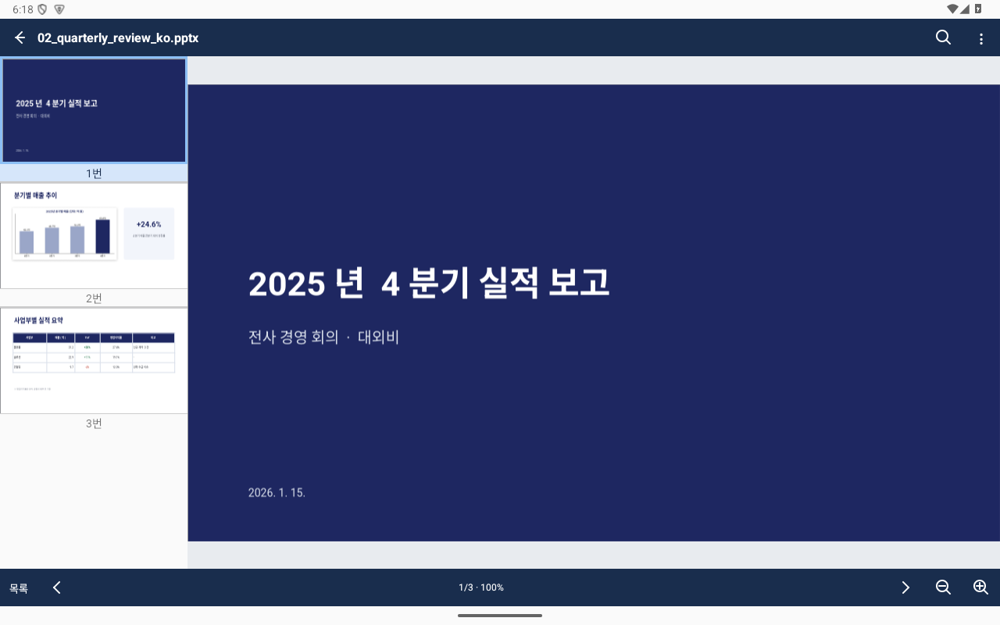

<div align="center">
  
  <h1>MIN VIEWER</h1>
  <p><b>여러 형식의 문서를 한곳에서 읽는 Android 문서 뷰어</b></p>
  <p>HWP · HWPX · Word · Excel · CSV · PowerPoint · PDF</p>
  <p><a href="#화면">화면 보기</a> · <a href="#사용-방법">사용 방법</a> · <a href="#주요-기능">주요 기능</a> · <a href="#개발과-빌드">개발과 빌드</a></p>
</div>

MIN VIEWER는 휴대폰과 태블릿에서 문서를 원본 페이지 형태로 살펴볼 수 있는 읽기 전용 앱임. 기기의 파일을 선택하거나 다른 앱에서 전달받아 열고, 페이지·시트·슬라이드를 이동하며 확인할 수 있음.

현재 개발 중인 앱으로, 아래 화면과 기능은 시험 빌드 기준임. 문서 형식과 사용 환경에 따른 검증 범위는 [검증 상태와 알려진 제한](#검증-상태와-알려진-제한)을 참고함.

## 화면

<div align="center">
  
  &nbsp;&nbsp;
  
  <p><b>최근 문서</b> &nbsp;&nbsp;·&nbsp;&nbsp; <b>문서 한쪽 보기</b></p>
  
  <p><b>넓은 화면의 슬라이드 목록</b></p>
</div>

화면은 Android 에뮬레이터에서 시험 문서를 열어 캡처한 이미지임. 실제 표시 내용은 문서와 화면 크기에 따라 달라질 수 있음.

## 사용할 수 있는 파일

| 형식 | 보기 방식 |
| --- | --- |
| **HWP · HWPX** | 한글 문서의 원본 페이지 보기 |
| **DOCX** | Word 문서의 페이지 보기 |
| **XLSX** | Excel 시트 보기와 시트 이동 |
| **CSV** | 행·열 표 보기와 행 번호 이동 |
| **PPTX** | PowerPoint 슬라이드와 미리보기 목록 |
| **PDF** | PDF 페이지 보기 |

DOC·XLS·PPT는 우선 지원 대상이 아니며, 충분한 실문서 호환성 검증 전 상태임. 모든 문서의 표시 일치나 모든 암호 방식의 동작을 보장하지 않음.

## 사용 방법

1. 홈의 **+** 버튼을 눌러 Android 파일 선택 화면에서 문서를 선택함. 파일을 전달하는 다른 앱의 열기·공유 메뉴에서도 MIN VIEWER를 선택할 수 있음.
2. 문서 화면에서 페이지·시트·슬라이드를 이동하고, 두 손가락으로 확대·축소함. 확대된 문서와 시트는 드래그해 이동함.
3. PDF와 한글은 메뉴에서 한쪽·연속·두쪽 보기를 선택함. 한쪽 보기가 기본이며, 두쪽 보기의 첫 페이지는 단독으로 표시함.
4. PPT는 목록 버튼으로 슬라이드를 선택함. 넓은 창에서는 왼쪽 목록을 접거나 펼칠 수 있음.
5. 홈의 최근 문서에서 다시 열고, 설정 메뉴에서 화면 테마와 사용자 글꼴을 관리할 수 있음. 최근 문서에 저장된 파일 접근이 만료되면 파일을 다시 선택해야 함.

카카오톡·이메일 앱에서 직접 전달하는 경로는 실제 앱과 기기에서 추가 검증이 필요함.

## 주요 기능

- **문서 탐색:** 페이지 이동, 한글·PDF 보기 방식 선택, Excel 시트 전환, PPT 슬라이드 목록 제공.
- **확대·이동:** 각 형식의 두 손가락 확대·축소 및 문서 영역 이동 제공.
- **문서 검색:** 한글과 Office 검색 제공. PDF 텍스트 검색은 **Android 15(API 35) 이상**에서 제공함.
- **최근 문서:** 기기에 저장된 최근 문서와 마지막 위치·보기 상태 복원 제공. 기록은 개별 또는 전체 삭제 가능함.
- **암호 문서:** 지원되는 형식에서 기기 내 비밀번호 입력 제공. PDF 암호 입력은 Android 15 이상에서 제공함.
- **글꼴 관리:** 사용자가 선택한 글꼴의 앱 전용 복사본을 추가·목록 확인·삭제할 수 있음. 사용 권한을 가진 글꼴을 사용해야 함.
- **화면 설정:** 시스템 설정을 따르는 테마와 라이트·다크 선택 제공. 창 너비에 따라 목록 배치를 조정함.

## 기술 구성

| 구성 | 사용 기술 |
| --- | --- |
| Android 앱 | Kotlin, Android SDK · 최소 Android 10(API 29) |
| PDF | Android `PdfRenderer` |
| HWP · HWPX | 수정된 rhwp 0.9.0의 WebAssembly 빌드 |
| DOCX · XLSX · PPTX | 직접 빌드한 LibreOfficeKit 26.2.6.3 ARM64 엔진 |
| CSV | 앱 내 CSV 파서 · UTF-8 및 CP949 선택 |

문서 처리는 기기에서 수행하며 읽기 전용으로 제공함. Android의 파일 선택과 `content://` 주소를 사용하며, 필요한 엔진에는 앱 내부 임시 파일을 전달함.
현재 Office 엔진 바이너리는 ARM64용이며 x86_64 에뮬레이터 시험은 바이너리 변환 환경에서 수행함.

## 검증 상태와 알려진 제한

- Android 에뮬레이터에서 형식별 문서 열기와 탐색·확대·오류 처리를 시험했으며, 일부 기능은 Galaxy Tab S10 Ultra에서도 시험함. 모든 실문서와 기기에서의 동일한 동작을 뜻하지 않음.
- PDF·한글·Office의 일부 문서와 페이지를 원본 출력과 비교함. 글꼴, 줄바꿈, 표·그림·차트 등은 문서마다 차이가 발생할 수 있음.
- 일부 한글 테마 차트의 색상이 원본과 다르고, 일부 수식은 글꼴에 따라 대체되거나 기호가 깨질 수 있음.
- 4096바이트 저장 구조의 암호 Excel 표본 1개에서 비밀번호 오류 안내와 열기를 확인함. 다른 파일·암호 방식과 실기기는 추가 검증이 필요함.
- 대형 CSV·Excel의 빠른 탐색은 현재 최적화 범위에서 제외함. 오래된 Word·Excel·PowerPoint 형식의 지원 범위도 확정되지 않음.
- 갤럭시 기기의 회전·분할 화면·폴더블 동작과 외부 앱 전달, 오프라인 사용 및 배포용 빌드 전반은 추가 검증이 필요함.

## 개발과 빌드

프로젝트는 Gradle을 사용함. Android SDK와 JDK 외에도 수정된 한글 엔진 및 LibreOfficeKit ARM64 산출물을 별도로 준비해야 함. 개발 도구와 엔진 바이너리는 저장소에 포함하지 않으므로, 저장소를 내려받은 직후에는 빌드가 완료되지 않음.

엔진 준비, 패치 적용 및 디버그 APK 빌드 절차는 [Android 빌드·시험 기록](docs/ANDROID_POC.md)을 참고함.

```powershell
.\gradlew.bat assembleDebug
```

## 프로젝트 문서

- [프로젝트 설계](docs/DESIGN.md) — 화면 구조와 기능 범위
- [Android 빌드·시험 기록](docs/ANDROID_POC.md) — 환경 준비, 빌드, 문서별 검증 결과
- [엔진 평가](docs/ENGINE_EVALUATION.md) — 문서 엔진 비교와 측정
- [개발 지침](AGENTS.md) — 구현 및 검증 원칙

사용한 엔진과 라이브러리의 고지는 [app/src/main/assets/licenses](app/src/main/assets/licenses)에서 확인할 수 있음. 프로젝트 자체의 별도 라이선스는 아직 명시되지 않았음.
